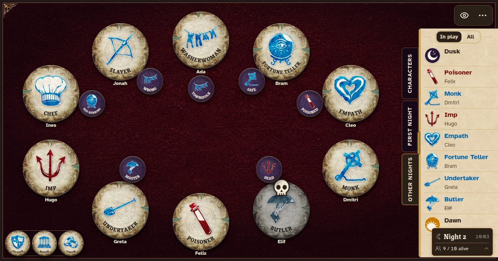

# BotC Grimoire

A digital grimoire for [Blood on the Clocktower](https://bloodontheclocktower.com) Storytellers.
Seats, character tokens, reminders and the night order, all on one phone or tablet.

Open it at [botcgrimoire.com](https://botcgrimoire.com). It runs in the browser, installs like an
app and works offline.



It's a grimoire, not a robot Storyteller. You run the game and the app keeps the board tidy: it
never resolves abilities, picks targets, works out information or decides who wins.

Unofficial, free and non-commercial fan project. Not affiliated with or endorsed by
The Pandemonium Institute.

## What you can do

- Run any edition or custom script, homebrew characters included, with up to twenty seats.
- Pass the phone round so each player draws a token, or deal them at random.
- Track characters, alignment, deaths, ghost votes, reminders and notes, plus Fabled, Loric and
  the Demon's bluffs.
- Keep the character list and both night orders next to the board.
- Record nominations and votes, then replay any finished game.
- Write, import, share and print your own scripts.

It's available in English, French, German, Spanish (Spain and Latin America), Polish, Swedish,
Finnish, Norwegian Bokmål and Hungarian.

## Playing offline

Open the site once and leave it open for a minute so the offline copy can download. Then install
it: use your browser's install button, or on iPhone and iPad, Safari's Share menu and Add to Home
Screen. From then on you need no connection and no account.

Updates arrive on their own when you're online, and your saved games stay. They live in your
browser, so clearing the site's data clears them too.

## Contributing

Found a bug or have an idea? [Open an issue](https://github.com/btroussel/botcgrimoire/issues/new/choose).
Pull requests are welcome too. A few easy ways in:

- Fix or improve the app's text in your language, in `src/content/locales/`. Character names and
  abilities come from the official [translation project](https://translation.botc.app), so fix
  those there.
- Make a screen nicer to use on a phone.
- Clear up something in the docs that confused you.

The one hard rule: the app never plays the game for the Storyteller, so no automating character
abilities. [CONTRIBUTING.md](CONTRIBUTING.md) has the rest, and [SECURITY.md](SECURITY.md) says how
to report a security issue privately.

## Running it locally

You need the Node version in `.nvmrc`. Then:

```sh
npm ci
npm start
```

`npm run check` runs the quick checks. To dig deeper, [the docs](docs/README.md) explain how the app
is built.

| Folder | What's in it |
| --- | --- |
| `src/` | The app itself |
| `assets/` | Game data and art, bundled so the app works offline |
| `public/` | Icons and other files served as they are |
| `docs/` | How the app works and why |
| `tools/` | Build and maintenance scripts, listed in [tools/README.md](tools/README.md) |

## Data and art

Character data, translations and art come from The Pandemonium Institute's public
[botc-release](https://github.com/ThePandemoniumInstitute/botc-release) and
[botc-translations](https://github.com/ThePandemoniumInstitute/botc-translations) repositories,
bundled so a game never needs the internet. For rules and rulings, the
[official wiki](https://wiki.bloodontheclocktower.com) is the reference.

## Licensing

The code and our own art are under the [MIT license](LICENSE). Blood on the Clocktower itself, its
name, art, ability text and other game content belong to The Pandemonium Institute (TPI), and the
MIT license doesn't cover them. That material lives in:

- `assets/data/raw/` and `assets/schema/`
- `assets/art/characters/`, `assets/art/editions/`, `assets/art/community/` and `assets/art/generic/`
- `src/content/generated/nightText.ts`
- `public/share.jpg` and `public/search.jpg`, screenshots showing official art

Game text quoted in `src/content/locales/*/night.json` is theirs too, and
[assets/README.md](assets/README.md) lists where every file comes from. TPI shares this material for
community tools under its
[Community Created Content Policy](https://bloodontheclocktower.com/pages/community-created-content-policy),
which is why this project stays free, non-commercial and clearly unofficial.
